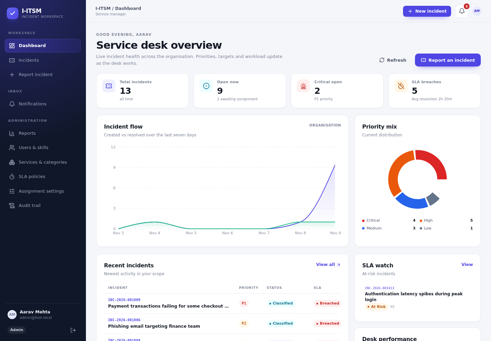

# I-ITSM — Intelligent IT Service Management & Incident Resolution

A full-stack incident management platform built for the **CS F213 / MAC F212 Object-Oriented
Programming** project. It covers the complete ITIL-style incident lifecycle — report, classify,
prioritize, assign, investigate, resolve, verify, close — with role-based access, configurable
SLAs, technician assignment strategies, notifications, audit history, reporting and intelligent
triage.

> **Stack:** Spring Boot 4.1.2 · Java 21 · PostgreSQL 17 (Alpine) · React 19 · Vite 8 · TypeScript 7



## Table of contents

- [Demo accounts](#demo-accounts)
- [Quick start](#quick-start)
- [Feature map](#feature-map)
- [Architecture at a glance](#architecture-at-a-glance)
- [How the intelligent features work](#how-the-intelligent-features-work)
- [Project layout](#project-layout)
- [Configuration](#configuration)
- [API summary](#api-summary)
- [Testing](#testing)
- [Documentation](#documentation)
- [Security notes](#security-notes)

## Demo accounts

The demo seeder runs automatically on an empty database (`app.seed.enabled=true`). All passwords are
case-sensitive.

| Role | Email | Password | Best for |
| --- | --- | --- | --- |
| Administrator | `admin@itsm.local` | `Admin@123` | Organisation-wide queue, reports, users, SLA policies, settings, audit |
| Technician | `priya@itsm.local` | `Tech@123` | Application / database / cloud incidents |
| Technician | `rohan@itsm.local` | `Tech@123` | Network / security / authentication incidents |
| Technician | `dev@itsm.local` | `Tech@123` | Application / authentication / network incidents |
| Employee | `employee@itsm.local` | `Employee@123` | Reporting incidents and tracking progress |
| Employee | `vikram@itsm.local` | `Employee@123` | Second reporter account |

The seeded database includes 13 incidents at different lifecycle stages, a P1 payment incident with
breached SLAs, a duplicate pair, an at-risk authentication incident, a technician workload mix, and
a complete audit trail. It is deliberately shaped so every dashboard and report is meaningful
immediately.

## Quick start

### Prerequisites

- Java 21 or newer (`java -version`)
- Node.js 20.19+ or 22.12+ (`node -v`)
- Docker with the Compose plugin (`docker compose version`)

### 1. Start PostgreSQL

```bash
docker compose up -d --wait db
```

The default host port is `5432`. If a local PostgreSQL already occupies it:

```bash
POSTGRES_PORT=5433 docker compose up -d --wait db
```

### 2. Start the backend

```bash
cd backend
./mvnw spring-boot:run
```

On first start, Flyway creates the schema and the demo seeder inserts the sample organisation. The
API listens on <http://localhost:8080>; health is at <http://localhost:8080/actuator/health>.

If you changed the PostgreSQL port, point the backend at it:

```bash
DB_URL=jdbc:postgresql://localhost:5433/app ./mvnw spring-boot:run
```

### 3. Start the frontend

```bash
cd frontend
npm install
npm run dev
```

Open <http://localhost:5173> and use one of the [demo accounts](#demo-accounts).

### Make shortcuts

```bash
make db-up       # start PostgreSQL and wait until healthy
make backend     # run Spring Boot
make frontend    # run Vite
make test        # backend tests (Testcontainers) + frontend lint/build
make build       # package backend + production frontend build
make verify      # tests + builds
make db-reset    # destroy and recreate the local database (fresh seed)
make db-down     # stop PostgreSQL (data kept)
```

## Feature map

| Project requirement | Implementation |
| --- | --- |
| Employee / Technician / Administrator accounts | JPA single-table inheritance (`User` → `Employee`, `Technician`, `Administrator`) with role-specific workspaces |
| Authentication & role-based authorization | Stateless JWT (JJWT), BCrypt passwords, Spring Security, `@PreAuthorize`, per-incident access checks |
| Incident create, view, update, assign, resolve, close | Full REST API + role-aware React UI, including edit-before-assignment and admin priority override |
| Impact / urgency / business criticality | Weighted priority engine with a documented score, rationale and configurable service criticality |
| At least two assignment strategies | Skill-based, load-based and round-robin, selectable at runtime by an administrator |
| SLA calculation, deadlines, violation detection | Global and service-specific policies, response/resolution targets, warning thresholds, scheduled monitor, breach flags |
| At least two notification mechanisms | Persistent in-app notifications plus simulated email (stored and logged); both driven by domain events |
| Complete incident history | Append-only audit table with actor, action, previous/new state, description and timestamp |
| At least five search/filter criteria | Search, status, priority, category, service, SLA state, date range, duplicates and escalations |
| At least two intelligent features | Auto-classification, duplicate detection, technician recommendations, SLA risk, escalation, suggested resolutions |
| Persistence | PostgreSQL 17 with Flyway migrations; Hibernate validates the schema |
| Reports and dashboards | Role-scoped KPIs, trend, priority mix, service/category analysis, technician workload, SLA health |
| Security | JWT, BCrypt, RBAC, ownership checks, validation, ProblemDetail errors, CORS allow-list |
| OOP design | Inheritance, interfaces, polymorphism, composition, state pattern, strategy pattern, factory, observer, repository, builder |

Detailed requirements traceability is in [docs/PROJECT_REPORT.md](docs/PROJECT_REPORT.md).

## Architecture at a glance

```text
┌─────────────────────────────┐        HTTPS / JSON + JWT        ┌──────────────────────────────┐
│ React 19 SPA                │ ───────────────────────────────▶ │ Spring Boot 4.1 API          │
│ Vite dev server + proxy     │                                  │ Web MVC · Security · JPA     │
│ Role-specific pages         │ ◀─────────────────────────────── │ Validation · Actuator        │
└─────────────────────────────┘                                  └──────────────┬───────────────┘
                                                                                  │ JDBC
┌─────────────────────────────┐                                  ┌──────────────▼───────────────┐
│ Scheduled SLA monitor       │ ◀──────── domain services ────── │ PostgreSQL 17 (Docker Alpine)│
│ Warnings · breaches ·       │                                  │ Flyway schema + demo data    │
│ auto-escalation             │ ──────── notifications ────────▶ │ Audit · notifications · SLA  │
└─────────────────────────────┘                                  └──────────────────────────────┘
```

Key design choices:

- **State pattern** for lifecycle transitions instead of scattered `if (status == ...)` checks.
- **Strategy pattern** for priority calculation and technician assignment; implementations are
  interchangeable without touching incident workflow code.
- **Observer pattern** through Spring application events: audit/notifications react to domain events
  rather than being hard-wired into controllers.
- **Factory pattern** for role-specific users, notification records and lifecycle state handlers.
- **Repository pattern** via Spring Data JPA.
- **Builder** for assembling realistic demo incidents.
- **Encapsulation** — incident transitions, feedback and duplicate links go through domain methods;
  services enforce actor permissions and business rules.

See [docs/ARCHITECTURE.md](docs/ARCHITECTURE.md) for component, class, use-case, sequence and state
diagrams.

## How the intelligent features work

### Priority (rule-based, explainable)

```text
raw   = impact(1–4) × urgency(1–4) × service criticality(1–4)
bonus = 0 / +1 / +3 / +6 / +10 for 5 / 25 / 100 / 500 affected users
score = raw + bonus
P1 score ≥ 36 · P2 ≥ 18 · P3 ≥ 6 · P4 otherwise
```

A total outage of a critical service (`EXTREME` impact + `CRITICAL` criticality) is always P1. Every
incident stores its score and a human-readable rationale. Administrators can override the priority
with a reason; the override is audited and recalculates the SLA clock.

### Auto-classification

A keyword signal engine scores the title and description against active categories (network, auth,
database, cloud, security, application, hardware, storage, etc.). Title matches are weighted more
heavily. The category and confidence are shown in the UI before submission; low-confidence reports
fall back to **Other** for manual triage. New categories introduced by an administrator become
available without code changes.

### Duplicate detection

Recent incidents are compared using a token-overlap similarity over title and description, with a
bonus when the affected service is the same. Matches above 30% are exposed as related incidents;
strong matches are linked as possible duplicates and admins are notified. A suggested-resolution
endpoint applies the same similarity approach to historical resolved incidents.

### Technician recommendations

Candidates are scored on skill match (40), available capacity (30), experience (15) and successful
history on the affected service (15). The assignment strategies use the same candidate set:

- **Skill-based** prioritises the category match, then fit score.
- **Load-based** prioritises the least busy qualified technician.
- **Round-robin** rotates across technicians with remaining capacity.

The strategy is stored in `system_settings`, can be changed live by an admin, and is applied to new
classifications.

### SLA monitoring

A scheduled monitor scans unresolved incidents for warning thresholds, response breaches, resolution
breaches and unacknowledged P1/P2 escalations. Warning/breach flags make the process idempotent, and
every event produces notifications and audit entries. Admins can trigger a scan manually from the
SLA or Reports page.

## Project layout

```text
.
├── backend/
│   ├── pom.xml
│   ├── mvnw / mvnw.cmd
│   └── src/
│       ├── main/java/com/example/itsm/
│       │   ├── common/          # base entity, errors, ProblemDetail, pagination
│       │   ├── config/          # clock
│       │   ├── security/        # JWT, principal, filter, security config
│       │   ├── user/            # User hierarchy, auth, admin user management
│       │   ├── catalog/         # services, categories and admin catalogue
│       │   ├── sla/             # policies, deadline calculation, monitor, SLA state
│       │   ├── incident/        # entity, repository, service, controller, DTOs
│       │   │   ├── lifecycle/   # state pattern
│       │   │   ├── priority/    # priority strategy
│       │   │   ├── assignment/  # assignment strategies + recommendations
│       │   │   └── search/      # JPA specification filters
│       │   ├── audit/           # append-only audit trail
│       │   ├── notification/    # events, listeners, in-app + simulated email
│       │   ├── intelligence/    # classification, duplicate detection, suggestions
│       │   ├── dashboard/       # role-scoped reports
│       │   ├── settings/        # assignment strategy + auto-assign
│       │   └── seed/            # realistic demo organisation
│       ├── main/resources/
│       │   ├── application.yml
│       │   └── db/migration/    # Flyway schema
│       └── test/                # 33 unit tests + Testcontainers integration test
├── frontend/
│   ├── src/
│   │   ├── api/                 # typed client + domain types
│   │   ├── auth/                # session context, login/register
│   │   ├── components/          # shell, notifications, shared UI
│   │   ├── pages/               # dashboard, incidents, detail, my work, reports, admin
│   │   ├── hooks/               # reusable query hook
│   │   └── lib/                 # formatting helpers
│   ├── vite.config.ts           # dev proxy for /api and /actuator
│   └── .env.example
├── docs/
│   ├── ARCHITECTURE.md          # component, class, state and sequence diagrams
│   ├── DATABASE.md              # ER diagram, schema and invariants
│   ├── API.md                   # endpoint reference
│   ├── TEST_CASES.md            # 60+ documented test scenarios
│   ├── PROJECT_REPORT.md        # submission-ready report (Markdown)
│   ├── I-ITSM_Project_Report.pdf # generated PDF report
│   ├── DEMO_SCRIPT.md           # 15–20 minute demo/video plan
│   └── screenshots/             # UI captures used in this README
├── docker-compose.yml           # postgres:17-alpine + healthcheck + volume
├── Makefile
└── README.md
```

## Configuration

### Backend

| Variable | Default | Purpose |
| --- | --- | --- |
| `DB_URL` | `jdbc:postgresql://localhost:5432/app` | JDBC URL |
| `DB_USERNAME` | `app` | Database user |
| `DB_PASSWORD` | `app` | Database password |
| `SERVER_PORT` | `8080` | API port |
| `JWT_SECRET` | dev-only default | HS384 signing key; **must** be ≥ 32 bytes in production |
| `JWT_EXPIRATION_MINUTES` | `480` | Token lifetime |
| `APP_SEED_ENABLED` | `true` | Insert demo data on an empty database |
| `SLA_MONITOR_INTERVAL_MS` | `30000` | Monitor delay between scans |
| `SLA_ESCALATION_INTERVAL_MINUTES` | `15` | Minutes per escalation level for unacknowledged P1/P2 |
| `CORS_ALLOWED_ORIGINS` | `http://localhost:5173,http://127.0.0.1:5173` | Allowed browser origins |

### Docker Compose

Values can be set in the shell or in a root `.env` file (copy `.env.example`):

| Variable | Default |
| --- | --- |
| `POSTGRES_DB` | `app` |
| `POSTGRES_USER` | `app` |
| `POSTGRES_PASSWORD` | `app` |
| `POSTGRES_PORT` | `5432` |

### Frontend

| Variable | Default | Purpose |
| --- | --- | --- |
| `VITE_PROXY_TARGET` | `http://localhost:8080` | Dev proxy target for `/api` and `/actuator` |
| `VITE_API_BASE_URL` | empty | Absolute API origin; bypasses the Vite proxy |

## API summary

All endpoints except login/registration require `Authorization: Bearer <jwt>`.

| Area | Endpoints |
| --- | --- |
| Auth | `POST /api/auth/login`, `POST /api/auth/register`, `GET /api/auth/me` |
| Incidents | `POST/GET /api/incidents`, `GET/PATCH /api/incidents/{id}` |
| Lifecycle | `POST /api/incidents/{id}/assign`, `/acknowledge`, `/start`, `/resolve`, `/verify`, `/close`, `/reopen`, `/cancel` |
| Participation | `POST /api/incidents/{id}/comments`, `/feedback`, admin `/priority-override` |
| Intelligence | `GET /api/incidents/{id}/duplicates`, `/suggested-resolutions`, `/recommended-technicians`, `POST /api/intelligence/classify` |
| Notifications | `GET /api/notifications`, `/unread-count`, `PATCH /{id}/read`, `POST /read-all` |
| Dashboard | `GET /api/dashboard` (role-scoped) |
| Technician | `GET /api/technicians/me/workload`, `GET /api/technicians` |
| Catalog | `GET /api/catalog/services`, `/categories`, `/sla-policies` |
| Admin | `/api/admin/users`, `/services`, `/categories`, `/sla-policies`, `/settings`, `/audit`, `/sla/scan` |
| Ops | `GET /actuator/health` |

Full request/response examples are in [docs/API.md](docs/API.md).

```bash
TOKEN=$(curl -s -X POST http://localhost:8080/api/auth/login \
  -H 'Content-Type: application/json' \
  -d '{"email":"employee@itsm.local","password":"Employee@123"}' | jq -r .token)

curl -s http://localhost:8080/api/incidents?priority=P1\&slaStatus=BREACHED \
  -H "Authorization: Bearer $TOKEN" | jq .
```

## Testing

```bash
cd backend && ./mvnw test        # 33 unit tests + 1 Testcontainers integration test
cd frontend && npm run lint      # oxlint
cd frontend && npm run build     # TypeScript project build + production bundle
```

The integration test starts a real `postgres:17-alpine` container with Testcontainers, runs Flyway,
seeds a minimal tenant, and exercises login → create → auto-assignment → acknowledge → start →
resolve → verify → close → feedback through MockMvc. Unit tests cover priority, lifecycle rules, SLA
deadlines/status, assignment strategies, classification, similarity, JWT and domain invariants.

[60+ documented test scenarios](docs/TEST_CASES.md) cover normal operations, boundaries, invalid inputs,
exceptions, authorization and business rules.

## Documentation

- [Architecture, UML, patterns and sequences](docs/ARCHITECTURE.md)
- [Database ER diagram and schema](docs/DATABASE.md)
- [REST API reference](docs/API.md)
- [Test cases and evidence](docs/TEST_CASES.md)
- [Project report (Markdown)](docs/PROJECT_REPORT.md) · [Project report (PDF)](docs/I-ITSM_Project_Report.pdf)
- [Demo/video plan](docs/DEMO_SCRIPT.md)
- [UI screenshots](docs/screenshots/)

## Security notes

Implemented:

- BCrypt password hashing; passwords are never returned by the API.
- Stateless HS384 JWT authentication with expiration.
- Role-based method security and per-incident ownership checks (employees can only see/report their
  own incidents; technicians only their assigned incidents; admins see the organisation).
- Internal notes are hidden from employees at the API layer.
- Bean Validation on all request DTOs and RFC 9457 `ProblemDetail` error responses.
- CORS allow-list, input length limits and HTTP status/exception mapping.
- Self-deactivation and last-admin deactivation guards; technician deactivation is blocked while
  they have active incidents.

This is a **course/demo system**, not a production deployment. Before production, move the JWT secret
to a secret manager, add refresh-token rotation/revocation, rate limiting, HTTPS, audit
retention/immutability, real email/SMS adapters, database backups and integration/performance tests.
See [PROJECT_REPORT.md](docs/PROJECT_REPORT.md#limitations-and-future-work).

## Database reset

```bash
docker compose down -v      # removes the volume and all data
docker compose up -d --wait db
cd backend && ./mvnw spring-boot:run
```

The seeder only runs when the `users` table is empty.

---

**Course:** CS F213 / MAC F212 Object-Oriented Programming · Semester I, 2026–2027  
**Project:** Intelligent IT Service Management & Incident Resolution System  
**Built with:** Spring Boot + PostgreSQL + React (Vite)
