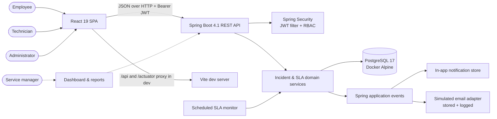
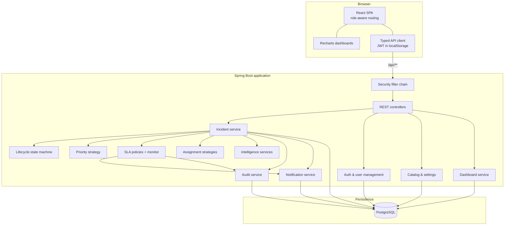
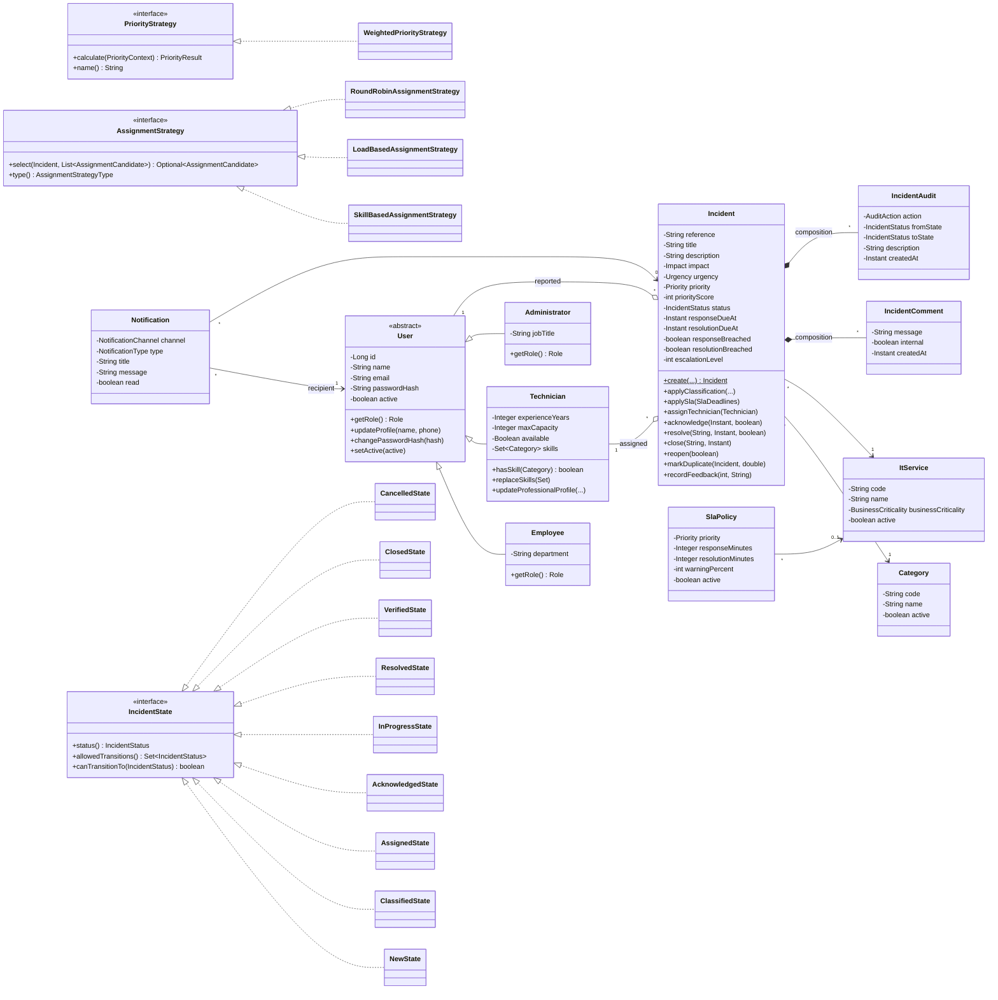
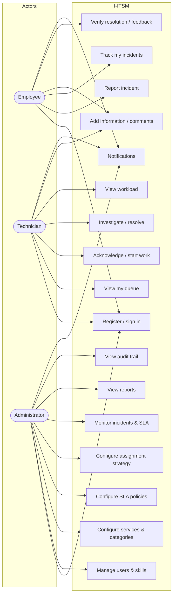
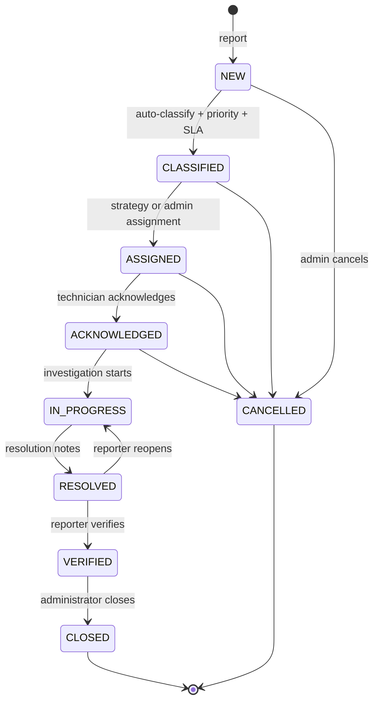
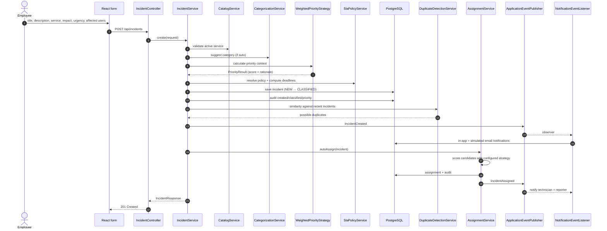
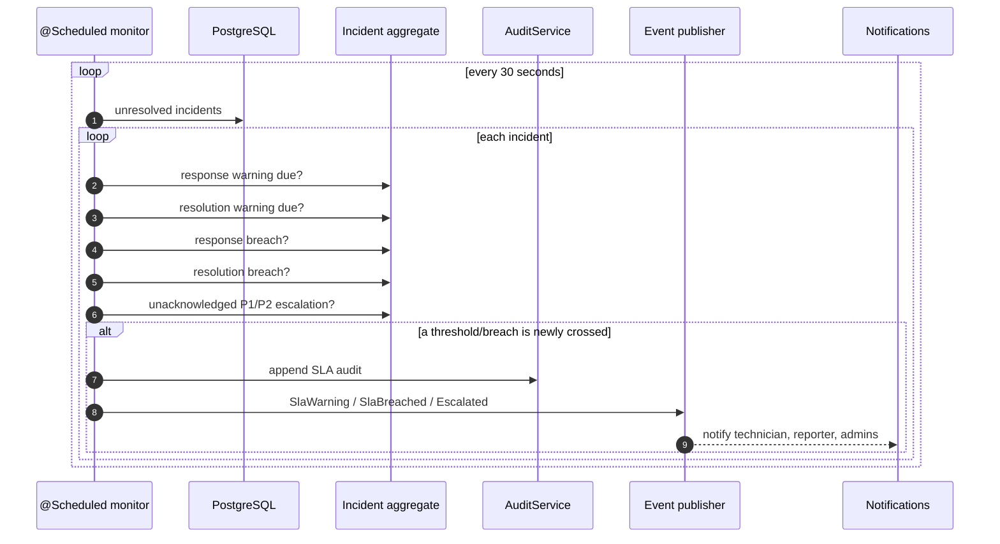
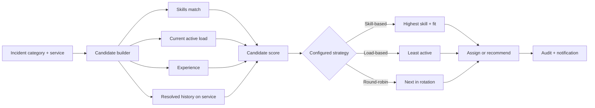
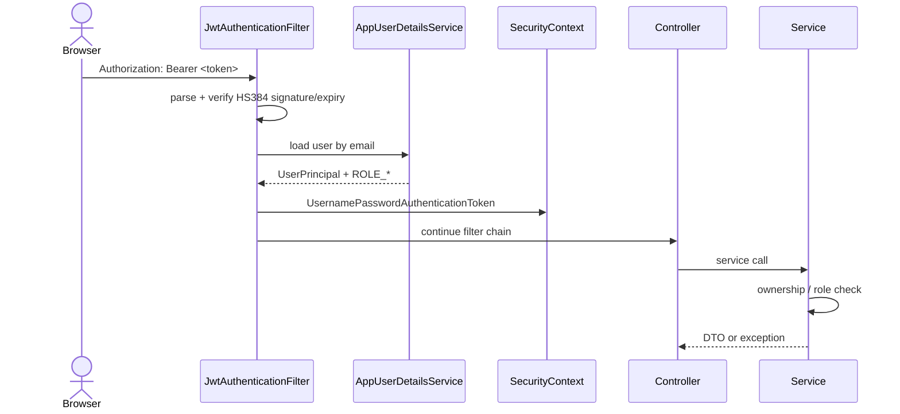

# Architecture

This document explains how I-ITSM is structured, how an incident moves through the system, which
object-oriented patterns are used, and where the important boundaries are.

## 1. Design goals and quality attributes

| Goal | How the architecture supports it |
| --- | --- |
| Maintainability | Feature-oriented packages, a small domain model with behaviour in entities, explicit service boundaries, DTOs at the API edge |
| Extensibility | Strategy interfaces for priority/assignment, state classes for lifecycle, domain events for notifications/audit, configurable catalogue and SLA policies |
| Correctness | State machine rejects illegal transitions, validation at the HTTP edge, business rules in services, optimistic locking on incidents |
| Security | Stateless JWT, BCrypt, method-level roles, per-incident authorization checks, internal-note filtering |
| Observability | Append-only audit trail, Actuator health, structured simulated-email logs, dashboard reports |
| Testability | Pure domain rules (priority, states, SLA math, similarity) isolated from persistence; integration test with a real PostgreSQL container |
| Performance | Indexed search columns, paginated queries, entity graphs for to-one relations, batched lazy loading |

## 2. System context

## 3. Container / component view

### Backend package boundaries

| Package | Responsibility |
| --- | --- |
| `security` | JWT parsing/validation, current user, Spring Security rules, JSON 401/403 handlers |
| `user` | User inheritance, login/registration, admin user management, technician directory |
| `catalog` | IT services, business criticality, categories, active/inactive lifecycle |
| `sla` | Global/service-specific policies, deadline arithmetic, SLA state, scheduled monitor, escalation |
| `incident` | Incident aggregate, REST API, search/filter specifications, DTO mapping, comments |
| `incident.lifecycle` | State pattern: allowed transitions and transition validation |
| `incident.priority` | Priority context/result and weighted strategy |
| `incident.assignment` | Candidate scoring, three assignment strategies, recommendation service |
| `incident.search` | JPA `Specification` filters and pagination query object |
| `audit` | Append-only incident audit records and admin audit API |
| `notification` | Domain events, observers/listeners, notification persistence, inbox API |
| `intelligence` | Keyword classification, duplicate similarity, resolution suggestions |
| `dashboard` | Role-scoped aggregation for KPIs, charts, workload and recent incidents |
| `settings` | Runtime assignment strategy and auto-assign switches |
| `seed` | Realistic demo organisation and incident history |
| `common` | Auditable base entity, exceptions, ProblemDetail advice, page response |

### Frontend structure

| Area | Responsibility |
| --- | --- |
| `api/client.ts` | Single fetch wrapper: JWT header, JSON, ProblemDetail parsing, 401 event |
| `api/types.ts` | Types mirroring API DTOs |
| `auth` | Session restore, login, registration, demo account quick-fill |
| `components` | App shell, role-aware navigation, notification bell, badges, modals, tables |
| `pages` | Dashboard, incident queue, create/report, incident detail, technician queue, notifications, reports |
| `pages/admin` | Users/skills, services/categories, SLA policies, assignment settings, audit |
| `hooks/useApi.ts` | Abort-safe GET hook with refetch and explicit loading/error state |

## 4. Domain model (class diagram)

**Inheritance note:** `User` is a genuine is-a hierarchy (`Employee`, `Technician`, `Administrator`
are all users but have different capabilities). It is persisted with `SINGLE_TABLE` inheritance and a
`user_type` discriminator, which keeps authentication queries simple. Technician-specific fields are
nullable for other user types, a deliberate trade-off documented in the database design.

**Composition vs association:** comments and audit entries are strongly owned by an incident
(deleting the incident cascades), while reporter/technician/service/category are associations to
independent aggregates. Duplicate linking is a self-association (`duplicateOf`).

## 5. Use cases by actor

## 6. Incident lifecycle state machine

Transitions are implemented with the **State pattern** (`IncidentState` and one class per status).
`IncidentWorkflowService` asks the current state whether a transition is allowed and throws
`InvalidStateTransitionException` (HTTP 409) otherwise. The API never exposes a generic
“set status” endpoint; each action has an explicit endpoint, audit entry and permission check.

## 7. Runtime sequence: employee reports an incident

All of the above happens in one transaction. Notification writes and audit rows roll back together
with the incident if any step fails.

## 8. Runtime sequence: SLA monitor

Flags (`responseWarningSent`, `responseBreached`, etc.) make every action idempotent: the monitor can
run every 30 seconds without duplicating notifications or audits. `SlaMonitorService.scan()` is also
callable through the admin endpoint for demonstrations.

## 9. Assignment and recommendation flow

The recommendations API exposes every candidate's score, skill match, active load, capacity and
availability so an administrator can make an informed manual choice.

## 10. Design patterns used

| Pattern | Where | Why |
| --- | --- | --- |
| **State** | `incident.lifecycle.*` | Encapsulates allowed transitions and prevents invalid lifecycle jumps |
| **Strategy** | `PriorityStrategy`, `AssignmentStrategy` + implementations | Priority algorithm and technician selection are independently replaceable |
| **Factory** | `UserFactory`, `NotificationFactory`, `AssignmentStrategyFactory`, `IncidentStateFactory` | Centralises creation and removes switch statements from services |
| **Observer / event-driven** | Spring `ApplicationEventPublisher` + `NotificationEventListener` | Notifications and audit side-effects are decoupled from core workflow |
| **Repository** | Spring Data JPA repositories | Persistence abstraction; domain services do not write SQL |
| **Builder** | `DemoDataSeeder.SeedBuilder` | Builds realistic incidents with many optional lifecycle fields |
| **Adapter (simulated)** | `EMAIL` channel in notification listener | A real provider can replace the log-based adapter without touching domain code |
| **Template method** | `AbstractIncidentState` | Shares status/transition storage across concrete state classes |
| **DTO / Mapper** | Request/response records + `IncidentMapper` | Keeps entities out of API contracts and hides internal fields |

Other OOP concepts:

- **Encapsulation** — entity fields are private; state-changing operations are methods; controllers
  never set status or timestamps directly.
- **Abstraction** — `PriorityStrategy`, `AssignmentStrategy`, `IncidentState` expose only meaningful
  behaviour.
- **Polymorphism** — `getRole()` is overridden by each user subtype; strategies are selected at
  runtime.
- **Composition** — incidents own comments/audits; services compose repositories, strategies and
  event publishers.
- **Exception handling** — domain-specific exceptions mapped to HTTP 400/401/403/404/409 with a
  consistent ProblemDetail body.

## 11. Security architecture

- Public routes: login, employee registration, health.
- Method security (`@PreAuthorize`) is the coarse gate; service-level checks enforce per-incident
  ownership and reporter/technician nuances.
- Internal comments are filtered in `IncidentService.detailResponse` for employees.
- JWT secret and expiration are externalised; the default is development-only.

## 12. Transactions, concurrency and consistency

- Spring `@Transactional` wraps incident creation, transitions, comments and admin changes.
- Incidents use `@Version` optimistic locking; a concurrent update receives a conflict rather than
  silently overwriting another actor's work.
- Domain events are synchronous within the transaction, so notification/audit writes are consistent
  with the incident change. (A production system could move email to an outbox for reliability.)
- SLA monitor work is idempotent and guarded by persisted flags.
- Reference numbers come from a PostgreSQL sequence; uniqueness is also enforced by a unique
  constraint.

## 13. Scalability path

The current architecture is a modular monolith, appropriate for a course project and an internal
service desk. If usage grows:

1. Replace full-table dashboard aggregation with database aggregate queries/materialised views and
   cache role-scoped totals.
2. Move SLA scanning and email delivery to a worker/queue (outbox + consumer) so request latency is
   unaffected.
3. Add refresh-token rotation, rate limiting and an API gateway.
4. Partition incidents by tenant/date and add tenant boundaries if the system becomes multi-tenant.
5. Extract notifications into a service if multiple clients (mobile/push/chat) are added.
6. Add OpenTelemetry traces/metrics; the Actuator and audit trail already provide a starting point.

The strategy/state abstractions and event decoupling are intentionally designed so these changes do
not require rewriting the domain workflow.
