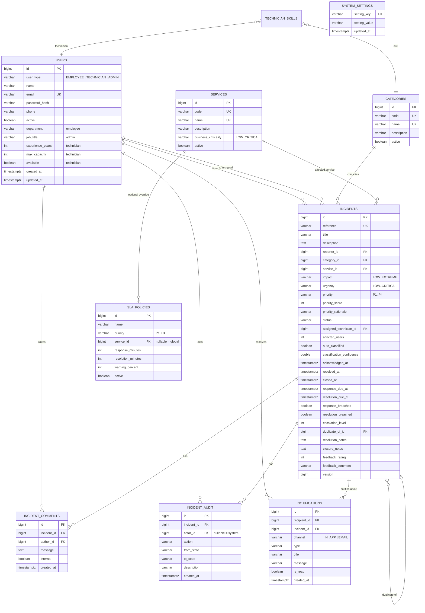

# Database design

I-ITSM uses **PostgreSQL 17** and **Flyway** migrations. Hibernate runs with
`ddl-auto=validate`, so the database schema is owned by SQL migrations, not by JPA auto-generation.

## 1. Entity-relationship diagram



## 2. Tables and responsibilities

### `users` — one table, three roles

`users` uses **single-table inheritance** with a `user_type` discriminator (`EMPLOYEE`,
`TECHNICIAN`, `ADMIN`). Shared authentication fields live here; role-specific fields are nullable for
other types.

| Column group | Notes |
| --- | --- |
| Identity | `id`, unique `email`, `name`, `phone` |
| Security | BCrypt `password_hash`, `active` |
| Employee | `department` |
| Technician | `experience_years`, `max_capacity`, `available` |
| Admin | `job_title` |
| Auditing | `created_at`, `updated_at` |

`technician_skills` is a many-to-many join between technicians and categories. Skills drive
skill-based assignment and recommendations.

### `categories`

Configurable incident classification. `code` is used by the keyword classifier (e.g. `NETWORK`) and
is immutable once created. Categories can be deactivated without deleting historical incidents.

### `services`

IT services with a **business criticality** of `LOW`, `MEDIUM`, `HIGH` or `CRITICAL`. Criticality is
one of the three weighting factors in the priority formula.

### `sla_policies`

A policy has a priority and either a service scope or `NULL` for the global policy. The service-
specific policy always wins during resolution.

```sql
-- Global policies: at most one active row per priority
CREATE UNIQUE INDEX uq_sla_global_priority ON sla_policies (priority) WHERE service_id IS NULL;

-- Service overrides: at most one row per (priority, service)
CREATE UNIQUE INDEX uq_sla_service_priority ON sla_policies (priority, service_id) WHERE service_id IS NOT NULL;
```

Targets are minutes from the incident creation timestamp. `warning_percent` determines when the
warning deadline occurs (for example, 80% of a 30-minute target = 24 minutes).

### `incidents`

The aggregate root and largest table.

| Area | Columns |
| --- | --- |
| Identity | `reference` (`INC-2026-001001`), `title`, `description` |
| Classification | `category_id`, `service_id`, `impact`, `urgency`, `priority`, `priority_score`, `priority_rationale`, `auto_classified`, `classification_confidence` |
| Lifecycle | `status`, `assigned_technician_id`, `acknowledged_at`, `resolved_at`, `closed_at` |
| SLA | `response_due_at`, `resolution_due_at`, `response_warning_at`, `resolution_warning_at`, breach/warning flags |
| Escalation | `escalation_level`, `last_escalated_at` |
| Duplicate analysis | `duplicate_of_id`, `duplicate_score` |
| Resolution | `resolution_notes`, `closure_notes` |
| Feedback | `feedback_rating` (1–5), `feedback_comment` |
| Integrity | `version` for optimistic locking |

Important indexes:

| Index | Purpose |
| --- | --- |
| `idx_incidents_status` | Queue and dashboard filters |
| `idx_incidents_priority` | Priority filters and reports |
| `idx_incidents_reporter` | Employee self-service scope |
| `idx_incidents_technician` | Technician queue/workload |
| `idx_incidents_created` (`DESC`) | Newest-first pagination and trends |
| `idx_incidents_resolution_due` | SLA monitor scans |

### `incident_comments`

Threaded updates on an incident. `internal = true` notes are visible only to technicians and
administrators; the API filters them out for employees. Comment creation is audited and notified.

### `incident_audit` — append-only history

Every action records:

- `incident_id`
- `actor_id` (nullable for system actions such as auto-classification and SLA monitor)
- `action` (e.g. `ASSIGNED`, `ACKNOWLEDGED`, `SLA_BREACHED`, `FEEDBACK_RECEIVED`)
- `from_state` / `to_state` when applicable
- human-readable `description`
- `created_at`

The table has no update/delete API; it is the canonical incident history. The admin audit page
paginates it globally, while the incident detail page shows it as a timeline.

### `notifications`

Persists **both mechanisms**:

- `IN_APP`: shown in the notification inbox and bell counter.
- `EMAIL`: stored as the simulated email log and printed to the server log.

Each row links the recipient, optional incident, type, title, message, read flag and timestamp.

### `system_settings`

Runtime configuration:

| Key | Values |
| --- | --- |
| `assignment.strategy` | `SKILL_BASED`, `LOAD_BASED`, `ROUND_ROBIN` |
| `assignment.auto-assign` | `true` / `false` |

## 3. Business invariants

| Invariant | Enforcement |
| --- | --- |
| Only valid lifecycle transitions happen | `IncidentWorkflowService` + state classes; API returns 409 |
| One global SLA policy per priority | Partial unique index + service-level duplicate check |
| Reference numbers are unique | PostgreSQL sequence + `UNIQUE(reference)` |
| Feedback rating is 1–5 | Bean Validation + `CHECK (feedback_rating BETWEEN 1 AND 5)` |
| Resolution target > response target | `SlaPolicyService` validation |
| Employees see only their incidents | Service-level reporter check on read/update |
| Technicians see only assigned incidents | Service-level assignment check |
| Internal notes are never exposed to employees | Comment filtering at the service layer |
| A technician cannot exceed configured capacity | Candidate filtering + manual-assignment capacity check |
| A deactivated technician cannot receive work | Candidate queries exclude inactive/unavailable staff |
| Last admin cannot be deactivated | `AdminUserService` guard |
| SLA monitor is idempotent | Persisted warning/breach flags |

## 4. Demo data

The `DemoDataSeeder` runs only when `users` is empty and `app.seed.enabled=true`. It creates:

- 10 categories and 8 services.
- 4 technicians with skills, experience and capacities; 2 employees; 1 administrator.
- 4 global SLA policies (P1–P4) plus a tighter payment-gateway P1 policy.
- 13 incidents across `CLASSIFIED`, `ASSIGNED`, `ACKNOWLEDGED`, `IN_PROGRESS`, `RESOLVED`,
  `VERIFIED` and `CLOSED`, with realistic timestamps, comments, breach flags, escalation levels and
  feedback.
- In-app and simulated-email notifications.
- A duplicate pair, an SLA-breached P1 payment incident, an at-risk authentication incident and a
  technician workload mix.

## 5. Migrations and reset

```bash
# Apply pending migrations / start the app
cd backend && ./mvnw spring-boot:run

# Reset the local database
docker compose down -v
docker compose up -d --wait db
cd backend && ./mvnw spring-boot:run
```

Do not edit a migration that has already been applied. Add a new `V{n}__description.sql` instead.
