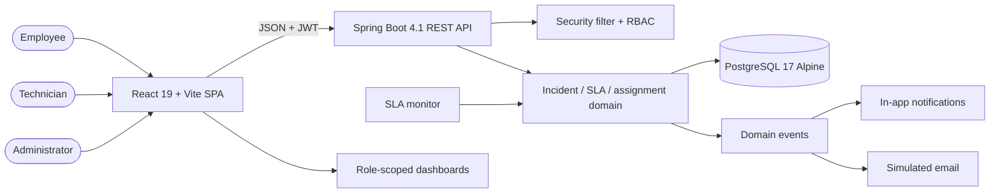
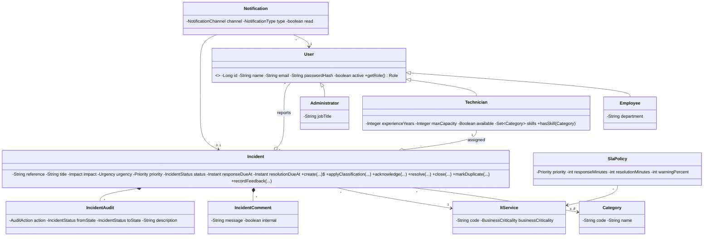
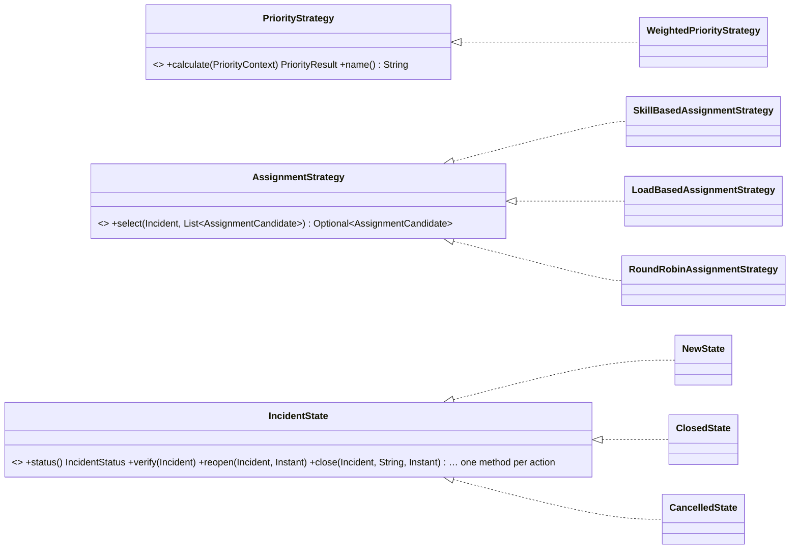
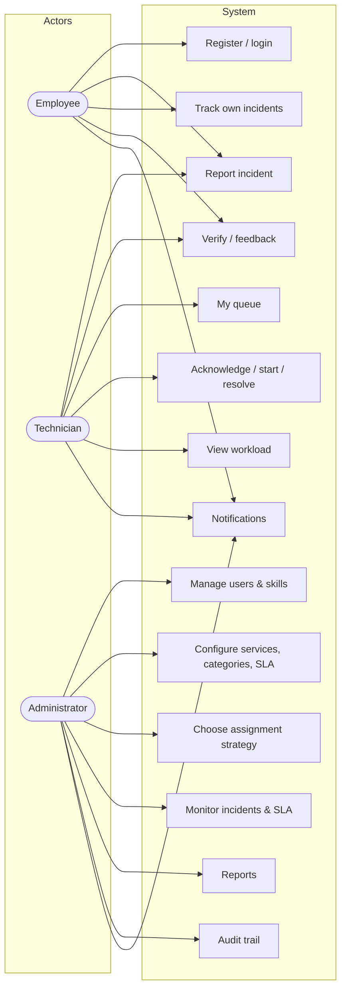
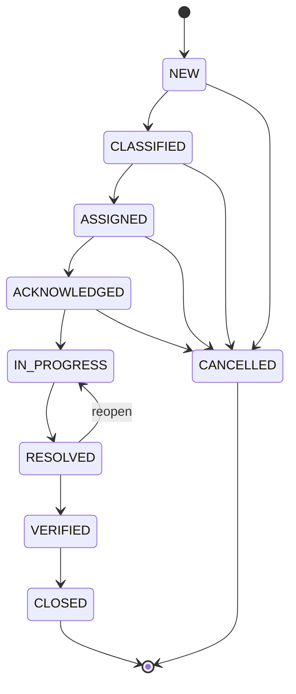
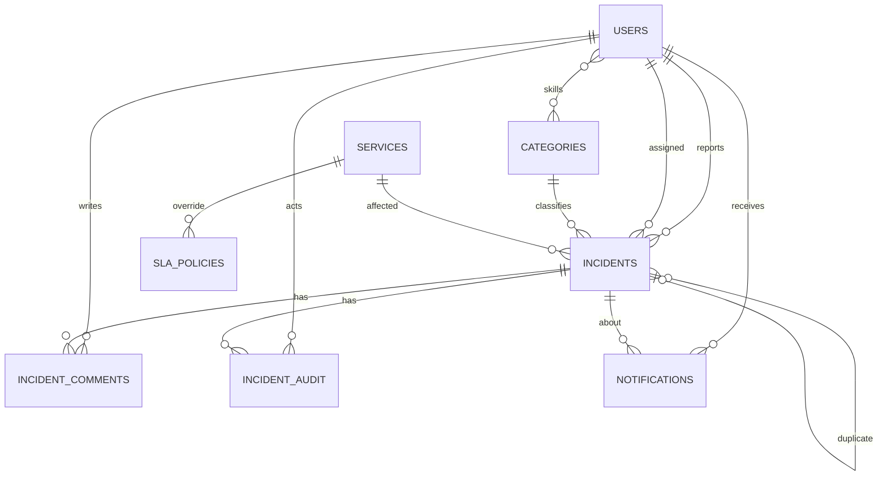

# Intelligent IT Service Management & Incident Resolution System (I-ITSM)

**Course:** CS F213 / MAC F212 Object-Oriented Programming  
**Semester:** I, 2026–2027  
**Project report:** implementation and design documentation

> Team details (names, roll numbers and primary responsibilities) should be completed from the
> submitted group before export. The technical content below is the report draft for the implemented
> system.

---

## Abstract

I-ITSM is a full-stack ITSM platform that manages the complete lifecycle of an IT incident: report,
classify, prioritize, assign, acknowledge, investigate, resolve, verify and close. It supports three
user groups — employees, technicians and administrators — with role-specific experiences and secure
JWT-based access. The backend applies object-oriented design through a state machine for lifecycle
transitions, strategy objects for priority calculation and technician assignment, factories,
repositories, domain events and an append-only audit trail. PostgreSQL stores the operational data
and Flyway owns the schema. The React frontend gives each role a purpose-built dashboard and
workflow.

The system goes beyond a basic CRUD application with rule-based auto-classification, duplicate
incident detection, smart technician recommendations, SLA warning/breach detection, automatic
escalation and suggested resolutions from historical incidents. It was validated with 44 automated
tests (including a real PostgreSQL Testcontainers integration test) and 60+ documented scenarios
covering authorization, invalid input, lifecycle rules and boundary conditions.

---

## Table of contents

1. Problem analysis
2. Requirements specification
3. System architecture
4. Object-oriented design and UML
5. Database design
6. Intelligent features
7. Security
8. Technology stack and justification
9. Testing and validation
10. Demonstration workflows
11. Evaluation rubric mapping
12. Limitations and future work
13. Conclusion
14. Appendices

---

## 1. Problem analysis

### 1.1 Problem

Large organisations depend on many IT services — payment platforms, identity providers, databases,
networks, storage and collaboration tools. When a service fails, the employee who notices it has no
structured way to report the problem, the support team must manually triage a flood of reports, and
managers lack timely visibility into service health and SLA performance. Common failures include:

- inconsistent incident descriptions and missing affected-service information;
- manual and subjective prioritisation;
- delayed or uneven technician allocation;
- missed SLAs and no early warning;
- duplicate reports of the same underlying failure;
- lost incident history and weak accountability;
- reports that cannot answer operational questions such as “which service is failing most?”.

### 1.2 Stakeholders

| Stakeholder | Goals | Pain points addressed |
| --- | --- | --- |
| Employee / customer | Report an issue quickly, track progress, provide extra information, verify the fix and give feedback | Simple report form, live status, comments, feedback |
| Technician | See assigned work, understand urgency, acknowledge, investigate, request information, resolve and manage workload | Personal queue, SLA clocks, internal notes, workload capacity |
| Administrator / IT manager | Manage people and services, configure SLAs and assignment, monitor incidents, review reports and audit | User/catalogue/SLA/settings admin, dashboards, audit trail |
| Organisation | Reduce downtime, meet contractual targets, make evidence-based staffing decisions | Priority automation, SLA monitoring, workload and service analytics |

### 1.3 Existing challenges

1. **Triage does not scale.** Manually reading every incident delays assignment and makes priority
   inconsistent.
2. **Assignment is opaque.** Choosing a technician without considering skills, load and experience
   leads to burnout and slow resolution.
3. **SLAs are reactive.** Deadlines are often discovered only after they are missed.
4. **Duplicates waste effort.** Similar reports arrive independently and are investigated separately.
5. **History is fragmented.** Chat threads and spreadsheets do not provide an auditable lifecycle.
6. **No role boundaries.** Employees, technicians and managers need different access and different
   views; a shared spreadsheet cannot provide that safely.

### 1.4 Proposed solution

I-ITSM provides one integrated platform with:

- a guided employee report form with automatic category suggestions and duplicate checks;
- explainable, rule-based priority scoring from impact, urgency, service criticality and affected
  users;
- configurable SLA policies per priority and per service, with response/resolution clocks, warnings,
  breach flags and escalation;
- three interchangeable technician assignment strategies plus ranked recommendations;
- in-app and simulated-email notifications driven by domain events;
- a complete, append-only audit trail;
- searchable, paginated incident queues and role-scoped dashboards/reports;
- administration screens for users, skills, services, categories, SLA policies and routing settings.

### 1.5 Assumptions

- Email/SMS delivery is simulated in the course environment; the notification abstraction allows a
  real provider to be added later.
- SLA targets in the demo are in minutes so that warnings and breaches can be observed during a
  short demonstration.
- The deployment is a single-tenant service desk. The model could be extended with a tenant column if
  required.
- Administrators are trusted service managers; privileged operations are still audited.
- The demo seeder is disabled in a production profile.

---

## 2. Requirements specification

### 2.1 User roles

| Role | Capabilities |
| --- | --- |
| Employee | Register/login, report incidents, view own incidents, add information, verify resolution, provide feedback, receive notifications |
| Technician | Login, report incidents and verify their own, view assigned incidents, acknowledge, start investigation, add internal/public notes, resolve, view workload, receive notifications |
| Administrator | Manage users, technicians and skills; manage services/categories; configure SLAs; choose assignment strategy; monitor incidents and SLA breaches; view reports and audit logs; assign/reassign; override priority; close/cancel |

### 2.2 Functional requirements

**FR-1 User management and authentication**

- FR-1.1 Employees can self-register; administrators can create all roles.
- FR-1.2 Passwords are hashed; login returns a signed JWT.
- FR-1.3 Every endpoint is protected by authentication except login/registration/health.
- FR-1.4 Role checks and per-incident ownership checks prevent unauthorized access.
- FR-1.5 Administrators can deactivate users, update technician capacity/skills and reset passwords.

**FR-2 Incident management**

- FR-2.1 Employees can create incidents with title, description, service, impact, urgency and affected
  users.
- FR-2.2 The system auto-classifies the category when none is supplied.
- FR-2.3 The system calculates priority and attaches the applicable SLA.
- FR-2.4 Employees can edit an incident before assignment; edits re-run classification.
- FR-2.5 Administrators can assign/reassign, override priority, cancel early incidents and close
  verified incidents.
- FR-2.6 Technicians can acknowledge, start and resolve assigned incidents with notes.
- FR-2.7 Reporters (of any role) can verify a resolution, reopen a resolved incident and leave feedback.
- FR-2.8 The system rejects invalid lifecycle transitions.
- FR-2.9 Any authenticated user can report an incident; the reporter is never assigned to their own incident.

**FR-3 Priority management**

- FR-3.1 Priority uses impact, urgency, service business criticality and affected users.
- FR-3.2 Every priority includes a score and a human-readable rationale.
- FR-3.3 P1/P2/P3/P4 map to configurable SLA policies.

**FR-4 Assignment**

- FR-4.1 At least two assignment strategies are available; I-ITSM implements three.
- FR-4.2 The strategy is configurable at runtime by an administrator.
- FR-4.3 The system scores skill match, load, experience and service history.
- FR-4.4 Technicians at capacity or unavailable are not auto-assigned.
- FR-4.5 Administrators can see recommendations and assign manually.

**FR-5 SLA management**

- FR-5.1 Policies define response/resolution targets and a warning percentage.
- FR-5.2 Policies can be global or service-specific; service-specific wins.
- FR-5.3 Response and resolution deadlines are calculated from creation time.
- FR-5.4 A scheduled monitor records warnings, breaches and escalation.
- FR-5.5 SLA status is exposed in list/detail APIs and dashboards.

**FR-6 Notifications**

- FR-6.1 In-app notifications are persisted and readable/markable.
- FR-6.2 Simulated email notifications are persisted and logged.
- FR-6.3 Creation, assignment, status change, comments, SLA warning/breach, escalation and duplicate
  detection produce notifications.
- FR-6.4 New channels are added as a new `NotificationSender` class; the dispatcher, event listener and domain stay unchanged.

**FR-7 Audit**

- FR-7.1 Every significant action records actor, action, previous/new state, description and time.
- FR-7.2 The audit trail is append-only and visible per incident and globally to administrators.

**FR-8 Search, filtering and reporting**

- FR-8.1 Search by title/description/reference.
- FR-8.2 Filter by status, priority, category, service, technician, reporter, SLA state, date range,
  duplicates and escalations.
- FR-8.3 Paginated result sets with deterministic ordering.
- FR-8.4 Dashboards show totals, priority/status mix, category/service analysis, seven-day trend,
  recent incidents, averages and technician workload.

**FR-9 Intelligent features**

- FR-9.1 Keyword-based auto-classification with confidence and rationale.
- FR-9.2 Duplicate detection with similarity scores and linking; matches the viewer may not open are shown without their title.
- FR-9.3 Ranked technician recommendations.
- FR-9.4 Suggested resolutions from similar resolved incidents.
- FR-9.5 SLA risk detection and automatic escalation.

**FR-10 Administration**

- FR-10.1 CRUD-like management (create/update/deactivate) for users, services and categories.
- FR-10.2 SLA policy management with validation.
- FR-10.3 Assignment strategy and auto-assign configuration.
- FR-10.4 Global audit view.

### 2.3 Non-functional requirements

| Requirement | Implementation |
| --- | --- |
| Security | JWT, BCrypt, RBAC, ownership checks, validation, CORS, ProblemDetail |
| Maintainability | Feature packages, interfaces/strategies, DTO mapping, Flyway schema |
| Testability | Pure unit-testable rules + Testcontainers integration test |
| Performance | Indexed filters, pagination, entity graphs, batched lazy loading |
| Reliability | Transactions, optimistic locking, idempotent SLA monitor |
| Usability | Role-specific home pages, “Waiting on you” prompts, a progress tracker on every incident, plain-language SLA timing, light/dark mode, responsive UI |
| Portability | Dockerised PostgreSQL; environment-driven config |
| Observability | Actuator health, audit trail, structured logs with simulated email |
| Extensibility | New categories/services/SLA policies from admin; new strategies/notifications by adding beans/listeners |
| Data integrity | Constraints, unique policies, reference uniqueness, validation |

### 2.4 Business rules

1. An incident cannot jump directly from NEW to CLOSED; the lifecycle must be followed.
2. Only the reporter or an administrator can edit an incident, and only before assignment.
3. Only the assigned technician can acknowledge/start/resolve.
4. Only the reporter (whatever their role) can verify and submit feedback; a technician is never assigned an incident they reported.
5. Only an admin can close a verified incident, cancel early incidents, reassign or override priority.
6. Feedback is allowed after resolution, exactly once.
7. A resolution target must be longer than its response target.
8. A technician cannot be assigned beyond capacity or while unavailable/inactive.
9. Deactivating a technician with active incidents is blocked; the last active admin cannot be
   deactivated; an admin cannot deactivate themselves.
10. Service-specific SLA policies override global policies of the same priority.
11. Internal notes are visible only to technicians and administrators.
12. P1/P2 incidents not acknowledged by the response deadline escalate over time.
13. Duplicate warnings never reveal the title of an incident the viewer is not allowed to open.

---

## 3. System architecture

### 3.1 Architectural style

I-ITSM is a **modular monolith** with a REST API and a separate SPA. A monolith was chosen because:

- the domain is cohesive and the expected load is moderate;
- a single transaction can keep incident state, audit and notifications consistent;
- it is easier to deploy and demonstrate within a course timeline;
- package boundaries and interfaces keep the door open for extracting services later.

### 3.2 High-level architecture



The SPA uses a typed API client and a Vite development proxy (`/api`, `/actuator`) to avoid CORS
complexity during development. The backend is stateless; the JWT carries identity and roles.

### 3.3 Backend components

| Component | Responsibility |
| --- | --- |
| Security | JWT filter, authentication provider, current-user service, security error handlers |
| User | Inheritance hierarchy, authentication, admin user management, skills |
| Catalogue | Services with criticality, categories, activation |
| SLA | Policy resolution, deadline arithmetic, status resolver, scheduled monitor, escalation |
| Incident | Aggregate, lifecycle orchestration, search, DTOs, comments, access control |
| Lifecycle | State classes that perform or refuse each lifecycle action |
| Priority | Weighted priority strategy and explainable result |
| Assignment | Candidate scoring, three strategies, recommendations |
| Intelligence | Classification, duplicate similarity, suggested resolutions |
| Audit | Append-only event log |
| Notification | Domain events, observers, in-app and simulated email |
| Dashboard | Role-scoped aggregation and analytics |
| Settings | Runtime assignment strategy/auto-assign |
| Seed | Realistic demonstration data |

### 3.4 Frontend structure

- A role-aware navigation shell and protected routes, with a light/dark mode switch.
- Employee home: “Waiting on you” (confirm or reject a fix in one click), requests in progress with a
  progress bar and plain-language timing, and recently fixed requests with a “Rate the fix” prompt.
- Dashboard for technicians and administrators with KPI cards, Recharts trend/donut/bar charts, SLA watch
  and the same “Waiting on you” prompt for incidents they reported.
- Incident queue with search + six visible filters and pagination.
- Report form with live smart-triage analysis and duplicate preview.
- Incident detail with a six-step progress tracker, an “Is it working for you now?” card for the reporter,
  SLA clocks, metadata, duplicate warning, suggestions, comments/internal notes, audit timeline and
  role-specific actions. Dashboard, home and detail pages refresh themselves every 10–15 seconds.
- Technician queue with capacity utilisation and deadline ordering.
- Admin screens for users/skills, services/categories, SLA policies, assignment settings and audit.
- Notification inbox with channel filters and unread handling.
- Responsive layout, mobile navigation drawer and accessible controls.

### 3.5 Request flow and consistency

Incident creation, transitions, comments and admin changes run in a single transaction. Domain events
are synchronous, so notification and audit writes commit with the incident change. Incidents use
optimistic locking (`@Version`) to prevent lost updates when two actors change the same incident.
SLA monitor operations are idempotent through persisted warning/breach flags.

---

## 4. Object-oriented design and UML

### 4.1 Class diagram (simplified)

**Domain classes**



**Strategy and state contracts**



One concrete `IncidentState` class exists for each status: `NEW`, `CLASSIFIED`, `ASSIGNED`,
`ACKNOWLEDGED`, `IN_PROGRESS`, `RESOLVED`, `VERIFIED`, `CLOSED` and `CANCELLED`. The state diagram in
[4.3](#43-state-diagram) shows the transition graph. The full diagram with every state class and
attribute is in [ARCHITECTURE.md](ARCHITECTURE.md#4-domain-model-class-diagram).

Each state class decides what every lifecycle action does. `AbstractIncidentState` refuses all actions
by default; for example only `ResolvedState` implements `verify()` and `reopen()`, and only
`VerifiedState` implements `close()`, so an incident cannot be closed before the reporter confirms the
fix. `IncidentService` simply asks the current state to perform the action.

### 4.2 Use-case diagram



### 4.3 State diagram



### 4.4 How OOP concepts are demonstrated

| Concept | Evidence |
| --- | --- |
| Encapsulation | Private entity fields; entity behaviour methods (`acknowledge`, `resolve`, `markDuplicate`); services enforce access; controllers only orchestrate |
| Abstraction | `PriorityStrategy`, `AssignmentStrategy`, `IncidentState`, repository interfaces |
| Inheritance | `User` hierarchy; `AbstractIncidentState`; concrete strategy classes implement shared contracts |
| Polymorphism | `getRole()` overridden per subtype; runtime strategy selection; state classes selected per status |
| Interfaces | Strategy/state/repository contracts, Spring Data repositories |
| Composition | `Incident` owns comments and audit records; services compose collaborators |
| Association/aggregation | Incident → reporter/technician/category/service; technician → skills |
| Exception handling | Domain exceptions mapped to HTTP statuses with ProblemDetail; state transition and capacity errors |
| Collections | Skill sets, candidate lists, audit timelines, paginated content, filtered queries |

### 4.5 Design patterns

| Pattern | Implementation | Benefit |
| --- | --- | --- |
| State | `IncidentState` + concrete states | Each state performs the actions it allows and refuses the rest; no status `if` chains in services |
| Strategy | Priority + three assignment strategies | Change algorithms without editing the service |
| Factory | User, notification, strategy, state factories | Centralized creation |
| Observer | Spring domain events + notification listener | Notifications/audit decoupled from workflow |
| Strategy (channels) | `NotificationSender` per channel + `NotificationDispatcher` | New notification mechanism = one new class |
| Repository | Spring Data JPA | Persistence abstraction and testability |
| Builder | Demo incident seeder | Complex optional lifecycle data assembled readably |
| Adapter | `EmailNotificationSender` → `EmailGateway` (`LoggingEmailGateway` simulates it) | Real email provider plugs in as another gateway |
| Template method | Abstract state class | Default refuse-everything behaviour that concrete states selectively override |
| DTO/mapper | Request/response records + mapper | Stable API contracts, no entity leakage |

---

## 5. Database design

I-ITSM uses PostgreSQL 17 with Flyway migrations. The complete ER diagram and column-level schema are
in [DATABASE.md](DATABASE.md). The core relationships are:



Key design choices:

- **Single-table user inheritance** with a `user_type` discriminator. Authentication queries stay
  simple and role-specific columns are nullable for other subtypes.
- **Normalized catalogue**: services and categories are independent aggregates referenced by
  incidents and technician skills.
- **SLA policy scoping**: global policies use a partial unique index on priority; service-specific
  policies use a unique `(priority, service_id)` index.
- **Incident history** is normalized into comments and audit tables; both cascade on incident
  deletion, while audit history remains append-only through the API.
- **Duplicate relationship** is a self-reference with an optional `ON DELETE SET NULL`.
- **Optimistic locking** through `version`.
- **Indexes** support status, priority, reporter, technician, created-at and resolution-due queries.

Sample data is generated by the seeder: 7 users, 4 technicians, 10 categories, 8 services, 5 SLA
policies (global + service-specific) and 13 incidents across every lifecycle stage, with comments,
audit records, notifications, breaches, escalation and feedback.

---

## 6. Intelligent features

### 6.1 Explainable priority

```text
raw   = impact(1–4) × urgency(1–4) × business criticality(1–4)
bonus = 0 / 1 / 3 / 6 / 10 for affected users <5 / ≥5 / ≥25 / ≥100 / ≥500
score = raw + bonus
P1 ≥ 36 · P2 ≥ 18 · P3 ≥ 6 · P4 otherwise
```

A total outage (`EXTREME` impact) of a `CRITICAL` service is forced to P1. The rationale string is
stored on the incident and shown in the UI, so users and evaluators can see exactly why a priority
was assigned. Administrators can override the priority with a reason; the override is audited and
recalculates SLA deadlines.

### 6.2 Auto-classification

An active-category keyword map scores the title and description (title matches count double). The
best category is returned with a confidence and rationale. For example, “VPN disconnects / Wi-Fi /
DNS” classifies as Network, “password / SSO / MFA” as Authentication, and unmatched reports fall back
to Other for manual triage. New categories added by an administrator are immediately available to the
classifier.

### 6.3 Duplicate detection and correlation

Text tokenization removes stop words and compares the title and description using an overlap
coefficient. A same-service bonus increases the score. Incidents above a candidate threshold are
returned as related incidents; strong matches are linked as possible duplicates (`duplicate_of_id`,
`duplicate_score`) and administrators are notified. The UI displays the duplicate banner and links to
the related reports. This directly addresses the brief's duplicate-report problem.

### 6.4 Smart technician recommendation

Each candidate receives a transparent score:

- 40 points for a category skill match;
- up to 30 points for free capacity;
- up to 15 points for experience;
- up to 15 points for successful history on the affected service;
- penalties for unavailable/at-capacity technicians.

The assignment strategies consume the same candidate set, while the recommendation endpoint shows
the ranked list with load, capacity, skills and service history for manual override.

### 6.5 SLA risk, breaches and escalation

The monitor scans unresolved incidents for warning thresholds, response breaches, resolution
breaches and unacknowledged P1/P2 incidents. Flags make it idempotent. An at-risk/breached/on-track/met
SLA state is computed from deadlines and flags and is exposed in every incident response and
dashboard. Escalation levels increase over time for unacknowledged critical incidents, notifying
administrators and adding audit entries.

### 6.6 Suggested resolution

Resolved incidents from the last 180 days are compared with the current incident using the same
similarity engine. The top matches return the resolution notes, timestamps and match scores, giving
technicians a starting point and improving organisational knowledge reuse.

---

## 7. Security

Implemented controls:

- BCrypt password hashing; password hashes never serialized.
- HS384 JWT with expiration; invalid/tampered tokens rejected.
- All APIs except login/registration/health require authentication.
- Method-level role checks plus service-level ownership checks:
  - every user sees incidents they reported;
  - technicians also see incidents assigned to them;
  - admins have organisation-wide access;
  - internal notes are filtered from employee responses;
  - all of these rules live in one class, `IncidentAccessPolicy`, which duplicate detection also uses so
    other people's incident titles are never revealed.
- Bean Validation on request DTOs, maximum lengths and enum values.
- RFC 9457 ProblemDetail responses; no stack traces or database details leaked.
- CORS allow-list; configurable origins.
- Optimistic locking; self-deactivation and last-admin guards; active-work deactivation guard.
- Demo accounts and seeded passwords are clearly development-only.

Limitations (documented for production): no refresh-token rotation/revocation, no rate limiting/
account lockout, no HTTPS termination in the development setup, simulated email, no MFA, and audit
rows are immutable by convention/API rather than by a database trigger. The report's future-work
section lists these.

---

## 8. Technology stack and justification

| Layer | Technology | Version | Role |
| --- | --- | --- | --- |
| Language | Java | 21 target (JDK 25 used to build/test) | Strong typing, mature OOP ecosystem, Spring support |
| Backend | Spring Boot | 4.1.2 | Web MVC, dependency injection, security, data access, scheduling |
| Security | Spring Security + JJWT | 7.x / 0.12.6 | JWT authentication, BCrypt, role-based authorization |
| Persistence | Spring Data JPA + Hibernate | Boot-managed | Repository abstraction, derived queries, specifications, optimistic locking |
| Migrations | Flyway | Boot-managed | Versioned schema evolution |
| Database | PostgreSQL | 17 Alpine (Docker) | Relational integrity, partial indexes, timestamptz, mature tooling |
| Frontend | React | 19.3 | Component model, large ecosystem, role-specific interfaces |
| Build/dev | Vite | 8.3 | Fast dev server, proxy, TypeScript bundling |
| Language (UI) | TypeScript | 7.0 | Typed API contracts, safer refactors |
| Routing | React Router | 7.x | Protected role-aware routes |
| Charts | Recharts | 3.x | Responsive dashboards |
| Testing | JUnit 6, AssertJ, Mockito, Testcontainers, Playwright | Boot-managed / current | Unit, integration, browser validation |
| Infra | Docker Compose | current | Reproducible PostgreSQL with healthcheck/volume |

### 8.1 Why Java?

Java offers a mature OOP runtime, static typing, excellent collections and a rich Spring ecosystem.
The project explicitly needs interfaces, inheritance, exceptions and a maintainable layered design;
Java expresses these clearly, and Spring Boot removes infrastructure boilerplate while keeping the
domain testable. Type safety also makes large domain refactors safer.

### 8.2 Why React?

React's component model maps naturally to role-specific pages and reusable UI (badges, SLA clocks,
tables, modals). Its ecosystem provides routing, charts and icons, and Vite gives fast feedback. The
frontend is a separate deployable SPA, which keeps the API language-independent.

### 8.3 Why Spring Boot?

Spring Boot provides production-grade REST, security, JPA, scheduling, validation and actuator
support with minimal configuration. Dependency injection supports the strategy/factory/observer
designs, method security expresses role rules cleanly, and the test slices/Testcontainers support
make both unit and integration testing practical.

### 8.4 Why PostgreSQL?

Incidents, users, audits and SLA policies are highly relational and benefit from foreign keys,
transactions and constraints. PostgreSQL adds partial unique indexes for SLA scoping, `timestamptz`
for deadlines, powerful filtering and a trustworthy concurrency model. It is also free, widely
available and easy to run in Docker Alpine. A document database would make reporting and relational
integrity harder for this domain.

### 8.5 Why a modular monolith + SPA?

The domain is cohesive and transaction consistency matters (incident + audit + notification). A
single backend is easier to deploy and demonstrate than microservices, while feature packages and
interfaces provide clear boundaries. The SPA provides a richer, role-specific UX than server-rendered
pages and can be hosted independently.

### 8.6 Alternatives considered

- **Node/Express or Django:** viable, but weaker fit for the requested OOP emphasis and the team's
  Java/Spring experience.
- **MongoDB:** flexible but poorer for the reporting joins, referential integrity and SLA policy
  constraints.
- **Microservices:** overkill for the project size and would complicate transactions and local
  deployment.
- **Server-rendered UI:** simpler, but less suitable for the interactive dashboards, timeline and
  role-specific workflows.
- **Client-side database:** rejected because persistence and multi-user consistency are core
  requirements.

### 8.7 Advantages and limitations of the stack

Advantages: strong typing, mature security, excellent relational support, fast frontend feedback,
easy local infrastructure, and a large ecosystem.

Limitations: Spring's startup time and memory footprint; JPA can hide N+1 queries if misused; the SPA
adds a separate build/deploy step; JWT revocation and refresh rotation are non-trivial; Docker is
required for the integration test. These are manageable at course-project scale.

### 8.8 How the stack supports OOP design

Java interfaces/abstract classes directly model strategies and states; Spring's DI makes them
swappable; JPA repositories express persistence contracts; exception hierarchies map domain failures
cleanly; React components and TypeScript interfaces mirror the domain DTOs; and the separation between
controllers, services, aggregates and repositories keeps responsibilities clear.

### 8.9 Evolution if users increase significantly

Add database-level reporting aggregates/materialized views, move SLA scanning and email into a
queue/worker, introduce refresh tokens and rate limiting, partition or archive old incidents, cache
role dashboards, add OpenTelemetry metrics/tracing, and extract notification/reporting services if
scale demands it. The existing strategy/state/event boundaries make these changes incremental.

---

## 9. Testing and validation

**Automated result:** 44/44 tests pass (40 unit + 4 integration). The integration test uses a real
`postgres:17-alpine` Testcontainers instance and exercises the complete HTTP workflow.

| Area | Automated tests | Manual verification |
| --- | --- | --- |
| Security | JWT validation/tamper; auth integration | Role boundaries, invalid login, 401/403, self-deactivation, internal notes |
| Lifecycle | State transitions; integration happy path | Edit/reopen/cancel/illegal transitions |
| Priority/SLA | Formula, bands, deadlines, statuses | Service-specific SLA, dashboard SLA states, monitor scan |
| Assignment | Three strategies, capacity filtering | Live strategy switch, recommendations |
| Intelligence | Classification, similarity | Duplicate preview/links, suggested resolutions |
| Reporting | — | Role-scoped dashboards, reports, filters, pagination |
| Audit/notifications | — | Full workflow timeline, channel rows, read/unread |
| Persistence | Flyway/Testcontainers | Fresh seed, reset and restart |

[TEST_CASES.md](TEST_CASES.md) documents 60+ test cases with preconditions, steps, expected results and
evidence. Additional negative checks were run manually for blank titles, unknown services, feedback
before resolution, duplicate feedback, editing after assignment, closing before verification,
deactivating a technician with active work, unknown endpoints and SLA monitor idempotence.

The UI was validated at 1440 px desktop and 390 px mobile widths with headless Chromium; no console
or page errors were observed during login, dashboards, queue, detail, forms, admin pages and the full
technician action flow.

---

## 10. Demonstration workflows

The demo plan is in [DEMO_SCRIPT.md](DEMO_SCRIPT.md). The three required workflows are:

1. **Report → triage → assignment → notification**
   Employee reports a payment outage; the system auto-classifies it, calculates P1, attaches the
   payment-specific SLA, detects a possible duplicate, assigns the best technician and notifies both
   parties.
2. **Investigate → resolve → verify → close**
   Technician acknowledges, starts work, adds an internal note, resolves with notes; the reporter
   verifies; the admin closes; feedback is captured; the audit timeline and notifications show every
   step.
3. **Correlation → SLA risk → escalation → reporting**
   A similar payment report is linked as a duplicate; a breached/at-risk incident is visible on the
   dashboard; the SLA monitor escalates an unacknowledged critical incident; the reports page shows
   workload, service/category analysis and SLA health; the audit log shows the full history.

The 15–20 minute video plan assigns each team member a module and a workflow segment.

---

## 11. Evaluation rubric mapping

| Rubric criterion | Marks | Evidence |
| --- | --- | --- |
| System design & architecture | 10 | Modular architecture, state/strategy/observer/factory/repository patterns, documented diagrams |
| Functionality implementation (MVP) | 60 | All mandatory modules: users, incidents, priority, assignment, SLA, notifications, audit, search/reporting, intelligence, persistence |
| User experience | 10 | Role-specific responsive UI, dashboards, smart triage form, SLA clocks, admin screens |
| Technical depth | 15 | Spring Security/JWT, JPA specifications, Testcontainers, event-driven notifications, optimistic locking, Flyway, reusable typed React architecture |
| Testing & validation | 5 | 44 automated tests, 60+ documented cases, negative/boundary checks |
| Innovation | 10 | Auto-classification, duplicate detection, technician recommendations, suggested resolutions, SLA risk detection, auto-escalation |
| Documentation & presentation | 10 | README, architecture/UML, ER design, API reference, test catalogue, report and demo script |

---

## 12. Limitations and future work

### Current limitations

- Email/SMS are simulated (stored + logged), not delivered by an external provider.
- No mobile push notifications or real-time WebSocket updates; the bell polls every 30 seconds.
- JWT access tokens only; no refresh rotation/revocation list.
- No MFA or password-reset email flow.
- The dashboard aggregates in memory, suitable for the demo dataset but not millions of incidents.
- The SLA monitor runs inside the API process.
- No committed browser E2E suite or CI pipeline.
- Single-tenant; no organisation boundaries.

### Future work

1. Notification adapters for SMTP/SMS/push/chat with an outbox and retries.
2. Real-time updates via SSE/WebSocket and a notification preference centre.
3. Refresh tokens, revocation, MFA, rate limiting and account lockout.
4. Database-level analytics, materialized views or a reporting warehouse for large volumes.
5. ML-assisted classification/similarity with human feedback loops, while keeping the rule-based
   fallback explainable.
6. Service dependency graph and incident correlation across related services.
7. Automated escalation policies configurable per service/priority, with on-call rosters.
8. CI/CD, Playwright E2E tests, load testing and observability dashboards.
9. Multi-tenancy and per-tenant SLAs.
10. Attachments, knowledge-base articles and a customer-facing portal.

---

## 13. Conclusion

I-ITSM demonstrates a complete, usable IT service management workflow rather than an isolated CRUD
exercise. The design applies object-oriented principles to the parts of the problem where they matter:
the incident lifecycle is a state machine, priority and assignment are interchangeable strategies,
notifications and audit are observers of domain events, and entities protect their own invariants.
The system meets every mandatory MVP requirement and adds meaningful intelligent features, a polished
role-specific interface and a substantial automated test suite. Its documentation covers architecture,
UML, database design, API contracts, tests and a video demonstration plan, providing a strong basis
for evaluation and future extension.

---

## 14. Appendices

### A. Demo accounts

| Role | Email | Password |
| --- | --- | --- |
| Admin | `admin@itsm.local` | `Admin@123` |
| Technician | `priya@itsm.local` | `Tech@123` |
| Technician | `rohan@itsm.local` | `Tech@123` |
| Technician | `dev@itsm.local` | `Tech@123` |
| Employee | `employee@itsm.local` | `Employee@123` |
| Employee | `vikram@itsm.local` | `Employee@123` |

### B. Run commands

```bash
docker compose up -d --wait db
cd backend && ./mvnw spring-boot:run
# another terminal
cd frontend && npm install && npm run dev
```

If port 5432 is occupied:

```bash
POSTGRES_PORT=5433 docker compose up -d --wait db
cd backend && DB_URL=jdbc:postgresql://localhost:5433/app ./mvnw spring-boot:run
```

### C. Reference documents

- [README](../README.md)
- [Architecture](ARCHITECTURE.md)
- [Database design](DATABASE.md)
- [API reference](API.md)
- [Test cases](TEST_CASES.md)
- [Demo script](DEMO_SCRIPT.md)
